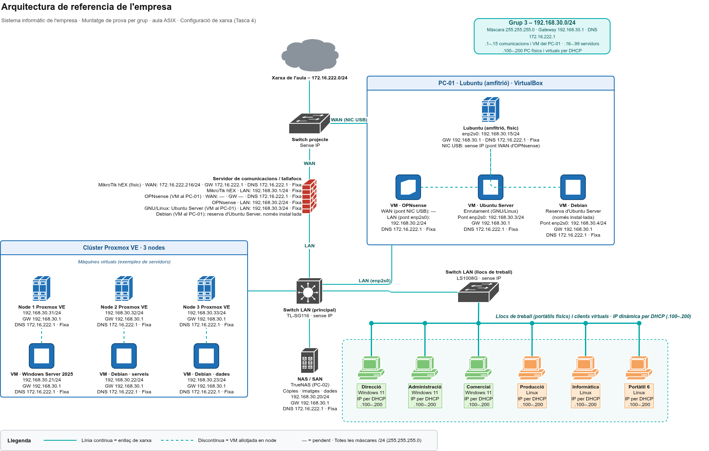

# 04 · Diseño físico y lógico

Tasca 4 «Disseny físic i lògic» · RA principales: FDM RA4; ISO RA1 y RA3.

## Esquema físico
Esquema de la Tasca 3 completado con la configuración de red de cada interfaz. Editable: [arquitectura-red-tasca4.drawio](../diagrames/arquitectura-red-tasca4.drawio). Exportación:

## Esquema lógico
Ver el mismo esquema.

## Direccionamiento

Red LAN del grupo: 192.168.30.0/24. Todas las máscaras son 255.255.255.0 (/24). «—» indica un dato pendiente; las IP WAN las asigna el profesorado.

| Rango | Uso |
|---|---|
| .1 – .15 | Servidores de comunicaciones y VM del PC-01 |
| .16 – .99 | Servidores y servicios (IP fija) |
| .100 – .200 | PC físicos (portátiles de clase) y virtuales: IP dinámica por DHCP |
| .201 – .254 | Libres (reserva) |

MikroTik, OPNsense y Ubuntu Server son las alternativas de servidor de comunicaciones. La puerta de enlace de la LAN es la del MikroTik (192.168.30.1). El DNS es el del centro (172.16.222.1). Los equipos por DHCP reciben como DNS el MikroTik (192.168.30.1), que reenvía las consultas al DNS del centro.

| Equipo | Físico o virtual | Interfaz | IP | Puerta de enlace | DNS | Método |
|---|---|---|---|---|---|---|
| MikroTik hEX | Físico | WAN (`ether1`) | 172.16.222.216 | 172.16.222.1 | 172.16.222.1 | Fija |
| MikroTik hEX | Físico | LAN | 192.168.30.1 | — | 172.16.222.1 | Fija |
| OPNsense | VM en el PC-01 | WAN (puente NIC USB) | — | — | 172.16.222.1 | Fija |
| OPNsense | VM en el PC-01 | LAN (puente `enp2s0`) | 192.168.30.2 | — | 172.16.222.1 | Fija |
| Ubuntu Server (enrutamiento) | VM en el PC-01 | Puente `enp2s0` | 192.168.30.3 | 192.168.30.1 | 172.16.222.1 | Fija |
| Debian (reserva de Ubuntu Server, solo instalada) | VM en el PC-01 | Puente `enp2s0` | 192.168.30.4 | 192.168.30.1 | 172.16.222.1 | Fija |
| PC-01 · Lubuntu (anfitrión) | Físico | `enp2s0` | 192.168.30.15 | 192.168.30.1 | 172.16.222.1 | Fija |
| PC-01 · Lubuntu (anfitrión) | Físico | NIC USB `enxb44bd6c64adc` | Sin IP (puente WAN de OPNsense) | — | — | — |
| NAS / SAN · TrueNAS (PC-02) | Físico | — | 192.168.30.20 | 192.168.30.1 | 172.16.222.1 | Fija |
| VM Windows Server 2025 | Virtual (nodo 1) | — | 192.168.30.21 | 192.168.30.1 | 172.16.222.1 | Fija |
| VM Debian · servicios | Virtual (nodo 2) | — | 192.168.30.22 | 192.168.30.1 | 172.16.222.1 | Fija |
| VM Debian · datos | Virtual (nodo 3) | — | 192.168.30.23 | 192.168.30.1 | 172.16.222.1 | Fija |
| Nodo 1 Proxmox VE | Físico | — | 192.168.30.31 | 192.168.30.1 | 172.16.222.1 | Fija |
| Nodo 2 Proxmox VE | Físico | — | 192.168.30.32 | 192.168.30.1 | 172.16.222.1 | Fija |
| Nodo 3 Proxmox VE | Físico | — | 192.168.30.33 | 192.168.30.1 | 172.16.222.1 | Fija |
| Dirección (Windows 11) | Físico | — | Dinámica (.100 – .200) | 192.168.30.1 (por DHCP) | 192.168.30.1 (por DHCP) | DHCP |
| Administración (Windows 11) | Físico | — | Dinámica (.100 – .200) | 192.168.30.1 (por DHCP) | 192.168.30.1 (por DHCP) | DHCP |
| Comercial (Windows 11) | Físico | — | Dinámica (.100 – .200) | 192.168.30.1 (por DHCP) | 192.168.30.1 (por DHCP) | DHCP |
| Producción (Linux) | Físico | — | Dinámica (.100 – .200) | 192.168.30.1 (por DHCP) | 192.168.30.1 (por DHCP) | DHCP |
| Informática (Linux) | Físico | — | Dinámica (.100 – .200) | 192.168.30.1 (por DHCP) | 192.168.30.1 (por DHCP) | DHCP |
| Portátil 6 (Linux) | Físico | — | Dinámica (.100 – .200) | 192.168.30.1 (por DHCP) | 192.168.30.1 (por DHCP) | DHCP |
| Clientes virtuales | Virtual | — | Dinámica (.100 – .200) | 192.168.30.1 (por DHCP) | 192.168.30.1 (por DHCP) | DHCP |
| Switch projecte, Switch LAN principal (TL-SG116) y de puestos (LS1008G) | Físicos | — | Sin IP (no gestionables) | — | — | — |

## Camino del tráfico y aislamiento entre LAN

> Cuando configuréis el servidor de comunicaciones y el filtrado, escribid aquí cómo y qué habéis hecho: por qué interfaces pasa el tráfico desde un cliente hasta Internet y cómo queda separada nuestra LAN de las de los otros grupos.

## Clúster: nodos, quórum, red y almacenamiento

> Cuando diseñéis el clúster, escribid aquí cómo y qué habéis hecho: cuántos nodos tiene, cómo funciona el quórum, qué red y qué almacenamiento usa, y la diferencia entre gestión conjunta, migración y alta disponibilidad. Si no hay nodos suficientes, indicad que queda como diseño o simulación.
