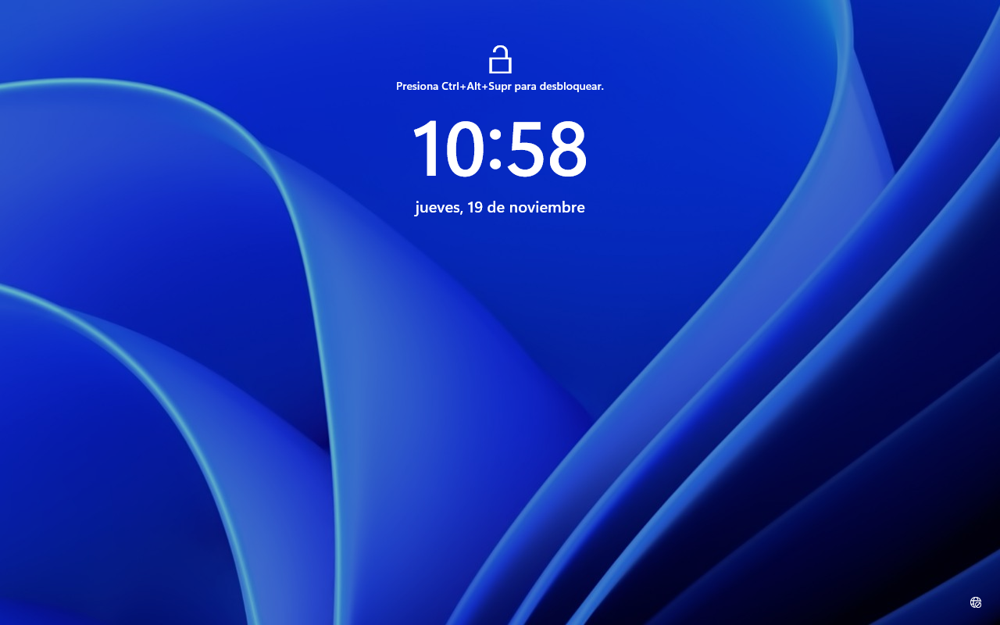

# 06 · Almacenamiento y recuperación

Tasca 6 «Emmagatzematge i recuperació» · RA principal: ISO RA3 a-h. Discos virtuales y datos ficticios.

La parte de grupo son los puntos 1, 2 y 4; el punto 3 es individual.

## 1. Sistemas de ficheros

Un sistema de ficheros es la forma en que un sistema operativo ordena los datos dentro de un disco: dónde empieza cada fichero, cómo se llama, de quién es y qué permisos tiene. Cada sistema operativo trae el suyo. Estos son los que usamos de verdad en nuestro montaje (comprobado con `lsblk -f` y `df -hT` en cada equipo; ver [05-installacions](05-installacions.md#2-firmware-arranque-particionado-y-sistema-de-ficheros)):

| Sistema de ficheros | Dónde lo usamos | Quién lo trae |
|---|---|---|
| **ext4** | Sistema de los tres nodos Proxmox, Lubuntu (PC-01), VM `Debian-RAID`, contenedor `ct-test` y los tres RAID de prueba | Linux |
| **ZFS** | TrueNAS: disco del sistema (SSD) y pool de datos `Pool_Principal` (HDD de 2 TB) | TrueNAS (también lo ofrece Proxmox) |
| **NTFS** | Windows Server 2025 (VM 100) y clientes Windows 11 | Windows |
| **FAT32 (`vfat`)** | Partición de arranque UEFI de todos los equipos | Lo exige UEFI |
| **NFS** y **SMB** | Carpetas del NAS vistas por la red: NFS para Proxmox, SMB para los clientes | No son de disco, son de red |

### Comparación

| Característica | ext4 | NTFS | ZFS | FAT32 |
|---|---|---|---|---|
| Tamaño máximo de un fichero | 16 TiB | 16 TiB o más | Sin límite práctico | **4 GiB** |
| Diario (*journal*): si se va la luz, el disco no queda a medias | Sí | Sí | No lo necesita: nunca escribe encima de lo que ya hay | No |
| Permisos por usuario y grupo | Sí, los de Linux (rwx) y ACL | Sí, ACL de Windows | Sí (ACL) | **No** |
| Detecta datos estropeados (suma de control de cada bloque) | Solo de sus propios datos internos | No | **Sí, de todo** | No |
| Instantáneas (*snapshots*) | No (hace falta LVM por debajo) | Con las «copias sombra» de Windows | **Sí, al instante** | No |
| Compresión | No | Sí, por carpeta | **Sí, por dataset** | No |
| RAID dentro del propio sistema de ficheros | No (se usa `mdadm` o LVM) | No (lo hace Windows aparte) | **Sí** (espejo, RAID-Z) | No |
| Memoria RAM que necesita | Poca | Poca | **Mucha**: usa la RAM libre como caché | Muy poca |
| Lo leen otros sistemas operativos | Linux; Windows no | Windows; Linux lo lee y lo escribe | Linux y FreeBSD; Windows no | **Todos** |

### Qué nos aporta cada uno en nuestro montaje

- **ext4 en los nodos, en Lubuntu y en las VM Linux.** Es sencillo, estable y gasta poca memoria. Nuestros nodos tienen la RAM justa (el nodo `pve` tiene ocupados 13,5 de 16 GiB), así que no conviene un sistema de ficheros que pida mucha. Lo que le falta (instantáneas y RAID) lo ponemos por debajo: LVM en los nodos y `mdadm` en la VM de los RAID.
- **ZFS en el NAS.** Es donde están las copias, y ahí es donde más nos aportan sus funciones:
  - **Compresión:** medida el 18/11, ahorra un 21 % en el pool (1,26x) y un 36 % en el dataset de las VM (1,56x).
  - **Instantáneas:** las hemos programado y probado (ver el [punto 4](#4-plan-de-contingencia)): recuperamos un fichero machacado en 5 s.
  - **Suma de control:** ZFS avisa si el disco devuelve un dato estropeado. Con un solo disco no puede repararlo, solo avisar.
  - **Lo que cuesta:** memoria. El NAS tiene 7,4 GiB y ZFS usa casi toda como caché (solo quedan unos 360 MiB «disponibles», y es normal). También es lento escribiendo «con seguridad» en un disco duro: lo medimos en la [Tasca 7](07-rendiment.md).
- **NTFS en Windows.** No se elige: Windows solo se instala en NTFS. Nos aporta los permisos de Windows (ACL), que son los que usa el dominio `grupo3.lan` para decir qué usuario entra en cada carpeta.
- **FAT32 en la partición de arranque.** Tampoco se elige: UEFI solo sabe leer FAT32. Como no tiene permisos ni diario, solo se usa para esa partición pequeña (300 a 512 MiB).

### Cómo nos afecta

- **Un fichero de más de 4 GiB no cabe en FAT32.** Las ISO de Windows Server (7,6 GiB) no se pueden guardar en un pendrive FAT32 tal cual.
- **Los permisos no viajan de un sistema a otro.** Al copiar de ext4 a una carpeta SMB del NAS, los permisos de Linux se pierden y mandan los del NAS. Por eso las copias de configuración se guardan dentro de un `.tar.gz`, que sí conserva dueño y permisos.
- **Windows no lee ext4 ni ZFS.** Si hubiera que sacar datos de un disco del NAS o de un nodo, haría falta un Linux. A los datos del NAS se entra siempre por la red (SMB o NFS), no enchufando el disco a otro equipo.
- **Las instantáneas no son una copia de seguridad.** Están en el mismo disco que los datos: sirven contra un borrado por error, no contra un disco roto.

## 2. RAID

Un RAID junta varios discos para que el sistema los vea como uno solo. Según cómo se junten, se gana velocidad, seguridad o las dos cosas. Los hicimos el 19/11 en la VM `Debian-RAID` (VM 101 del nodo pve2, Debian 13), que tiene tres discos virtuales de 5 GB solo para esto (`sdb`, `sdc` y `sdd`). Usamos `mdadm`, la herramienta de RAID por software de Linux.

Todos los comandos y sus salidas están en la evidencia [t6-raid-debian-20261119.txt](../evidencies/t6-raid-debian-20261119.txt).

### Preparación

1. **Instalar `mdadm`:** `apt install mdadm`.
2. **Partir cada disco en tres trozos de 768 MiB**, de tipo «Linux RAID». Así, con solo tres discos, podemos tener los tres RAID funcionando a la vez y compararlos. Se usan trozos pequeños porque los discos de la VM están en un almacenamiento del nodo que solo tiene 11 GiB reales (ver [05-installacions](05-installacions.md)).

   ```
   sfdisk /dev/sdb     # y lo mismo en sdc y sdd: tres particiones de 768M
   ```

### Los tres RAID

| | RAID 0 (`md0`) | RAID 1 (`md1`) | RAID 5 (`md5`) |
|---|---|---|---|
| Cómo reparte los datos | Los trocea y pone un trozo en cada disco | Escribe lo mismo en los dos discos (espejo) | Reparte los datos y guarda además un dato de comprobación (paridad) que va cambiando de disco |
| Discos que usa | 2 (`sdb1`, `sdc1`) | 2 (`sdb2`, `sdc2`) | 3 (`sdb3`, `sdc3`, `sdd3`) |
| Comando | `mdadm --create /dev/md0 --level=0 --raid-devices=2 /dev/sdb1 /dev/sdc1` | `mdadm --create /dev/md1 --level=1 --raid-devices=2 /dev/sdb2 /dev/sdc2` | `mdadm --create /dev/md5 --level=5 --raid-devices=3 /dev/sdb3 /dev/sdc3 /dev/sdd3` |
| Espacio útil (con trozos de 768 MiB) | 1.532 MiB: **la suma de los dos** | 767 MiB: **el de uno solo** | 1.532 MiB: **el de todos menos uno** |
| Espacio que se «pierde» | Nada | La mitad | Un disco de tres (33 %) |
| Discos que pueden fallar sin perder datos | **Ninguno** | 1 | 1 |

Después de crearlos, cada uno se formatea y se monta como un disco normal:

```
mkfs.ext4 -L md0 /dev/md0        # igual con md1 y md5
mount /dev/md0 /mnt/md0
```

El estado se ve en cualquier momento con `cat /proc/mdstat`. `[UU]` o `[UUU]` significa que todos los discos están bien; un guion bajo (`[U_]`) es un disco que falta.

### Comprobación 1: velocidad

Medido con `fio` dentro de la VM, con un fichero de 256 MiB y sin caché:

| Prueba | RAID 0 | RAID 1 | RAID 5 |
|---|---|---|---|
| Escribir un fichero grande | **996 MiB/s** | 544 MiB/s | 593 MiB/s |
| Leer un fichero grande | 2.349 MiB/s | 2.438 MiB/s | 2.306 MiB/s |
| Escribir trozos pequeños (4 KiB) al azar | **13.400 por segundo** | 8.470 por segundo | 5.206 por segundo |

- **RAID 0 es el más rápido escribiendo**, casi el doble que RAID 1, porque reparte el trabajo entre los dos discos.
- **RAID 1 escribe más lento** porque cada dato lo escribe dos veces.
- **RAID 5 es el más lento con trozos pequeños** (menos de la mitad que RAID 0): por cada escritura tiene que volver a calcular y guardar la paridad.
- **Leyendo van los tres igual.** Aquí los tres «discos» son ficheros del mismo disco real del servidor de clase, así que las cifras sirven para comparar los RAID entre sí, no como velocidad real de unos discos de verdad.

### Comprobación 2: qué pasa cuando falla un disco

Antes de la prueba guardamos en cada RAID un fichero ficticio de 100 MiB y apuntamos su suma SHA256. Si después del fallo la suma coincide, el fichero no se ha estropeado.

| | RAID 0 | RAID 1 | RAID 5 |
|---|---|---|---|
| Cómo provocamos el fallo | Borramos la marca de RAID de `sdc1` (como si el disco viniera vacío) | `mdadm /dev/md1 --fail /dev/sdc2` | `mdadm /dev/md5 --fail /dev/sdd3` |
| Qué pasó | **El RAID no arranca**: `Not enough devices to start the array` | Sigue funcionando con un disco: `[U_]` | Sigue funcionando con dos discos: `[UU_]` |
| Los datos | **Perdidos** | Intactos (`La suma coincide`). Incluso pudimos escribir un fichero nuevo con el disco roto | Intactos (`La suma coincide`) |
| Cómo se arregla | No se puede. Hay que crear el RAID de nuevo y recuperar los datos de una copia | Se quita el disco roto y se añade uno nuevo: `mdadm /dev/md1 --remove /dev/sdc2` y `mdadm /dev/md1 --add /dev/sdd2` | Igual: `--remove` y `--add` |
| Tiempo de reconstrucción | — | **8,5 s** (767 MiB) | **8,8 s** (767 MiB) |
| Tiempo sin servicio | Todo el que se tarde en rehacerlo y restaurar la copia | **0 s** | **0 s** |

En RAID 0, `mdadm` ni siquiera deja marcar un disco como roto (`Device or resource busy`): no hay ninguna copia con la que seguir trabajando.

Mientras un RAID 1 o un RAID 5 está con un disco menos (*degradado*) sigue dando servicio, pero ya no aguanta otro fallo. Por eso hay que cambiar el disco cuanto antes. La reconstrucción tarda según el tamaño: aquí fueron 8 s porque los trozos son de 768 MiB; con discos de 2 TB serían horas.

### Comprobación 3: que sigan ahí al reiniciar

Para que la VM monte los RAID sola al arrancar:

```
mdadm --detail --scan >> /etc/mdadm/mdadm.conf    # apunta qué RAID hay
update-initramfs -u                               # para que el arranque los conozca
# y una línea por RAID en /etc/fstab:
LABEL=md1 /mnt/md1 ext4 defaults,nofail 0 2
```

`nofail` hace que el sistema arranque aunque un RAID no esté; sin eso, un RAID roto dejaría la VM sin arrancar. Reiniciamos la VM (15 s): los tres RAID volvieron montados, con `[UU]` y `[UUU]`, y las sumas de los ficheros seguían coincidiendo.

### Qué ganamos con cada uno

| RAID | Qué ganamos | Qué perdemos | Para qué lo usaríamos |
|---|---|---|---|
| **RAID 0** | Velocidad y todo el espacio | Seguridad: con un disco roto se pierde todo. Con dos discos hay el doble de probabilidad de fallo | Datos que se pueden volver a generar: temporales, cachés. **Nunca** para datos de la empresa |
| **RAID 1** | Seguridad con solo dos discos; se recupera fácil y rápido | La mitad del espacio | El disco del sistema de un servidor, o los datos del NAS con dos discos |
| **RAID 5** | Seguridad perdiendo solo un disco de espacio | Escritura más lenta; con discos grandes la reconstrucción es larga y, si falla otro disco mientras tanto, se pierde todo | Almacenes de datos con tres discos o más, donde importa el espacio |

**Un RAID no es una copia de seguridad.** Protege de un disco roto, pero no de borrar un fichero por error, de un virus ni de un incendio: lo que se borra, se borra en todos los discos a la vez.

**En nuestro montaje:** el NAS guarda todas las copias en un solo disco (`Pool_Principal` es un *stripe* de un disco, que equivale a no tener RAID). Con lo visto aquí, lo correcto para la empresa sería un segundo disco de 2 TB en espejo (RAID 1), que en ZFS se llama *mirror*.

## 4. Plan de contingencia

Un plan de contingencia dice, para cada cosa que puede fallar, qué se hace, quién lo hace, con qué copia y cuánto se tarda. Lo preparamos y lo probamos el 19/11.

### Qué es crítico y cuánto podemos estar sin ello

| Sistema | Por qué es crítico | Tiempo máximo parado que aceptamos | Datos que aceptamos perder |
|---|---|---|---|
| MikroTik (router) | Sin él no hay Internet ni DHCP para nadie | 15 min | Ninguno (su configuración casi no cambia) |
| Windows Server (dominio `grupo3.lan`) | Sin él no se puede iniciar sesión con usuarios del dominio | 30 min | Los cambios de un día |
| TrueNAS (NAS) | Guarda los documentos, las copias y los discos de las VM | 1 hora | Los documentos de una hora |
| Clúster Proxmox | En él funcionan los servidores | 15 min por nodo | Ninguno (las VM están en el NAS) |
| Clientes | Si uno falla, el usuario puede usar otro | 1 día | Ninguno (los documentos van al NAS) |

### Qué copias tenemos

Dónde está cada copia y cómo se hizo: [Espacio de copias de seguridad](05-installacions.md#espacio-de-copias-de-seguridad). Lo que añadimos el 19/11 para este plan:

| Qué | Cada cuánto | Cuántas se guardan | Dónde |
|---|---|---|---|
| Copia completa de las VM 100 (Windows Server) y 101 (`Debian-RAID`) y del contenedor 102 | De lunes a viernes a las 12:30 (trabajo `copia-diaria-g3` de Proxmox) | Las 3 últimas | `truenas-nfs`, carpeta `dump/` |
| Instantáneas de `Documentos` y `Configuraciones` | Cada hora | 2 semanas | En el propio NAS |
| Instantánea de `proxmox` (discos de las VM) | Cada día a las 2:00 | 1 semana | En el propio NAS |
| Configuración del MikroTik (`.backup` y `.rsc`, con su SHA256) | A mano, después de cada cambio | Todas | `Configuraciones/Mikrotik` |

Las copias de Proxmox se pusieron a las 12:30 porque los equipos del aula se apagan por la tarde; de noche no se harían.

Evidencias: [t6-proxmox-copia-programada-20261119.txt](../evidencies/t6-proxmox-copia-programada-20261119.txt) y [t6-truenas-instantaneas-20261119.txt](../evidencies/t6-truenas-instantaneas-20261119.txt).

### Qué hacer en cada caso

| Qué falla | Cómo se nota | Qué se hace | Copia que se usa |
|---|---|---|---|
| Un fichero borrado o machacado en el NAS | Lo dice el usuario | Recuperarlo de la instantánea: carpeta oculta `.zfs/snapshot/<fecha>/` del dataset, o **Datasets → Manage Snapshots** | Instantánea de cada hora |
| Una VM o un contenedor borrado o estropeado | No arranca o no responde al `ping` | En Proxmox: almacenamiento `truenas-nfs` → **Respaldos** → elegir la copia → **Restaurar** | Copia diaria de `dump/` |
| Un disco de un RAID | `cat /proc/mdstat` muestra `[U_]` | `mdadm --remove` del disco roto y `mdadm --add` del nuevo. No hay que parar nada | No hace falta |
| Un nodo Proxmox apagado | Sale en gris en la web; el clúster sigue con 2 votos de 3 | Encenderlo. Si no vuelve, arrancar sus VM en otro nodo: sus discos están en el NAS | No hace falta |
| Una regla o un ajuste del MikroTik | Algo deja de funcionar; se ve en **Log** | Volver a crear lo perdido copiándolo del `.rsc` | `Configuraciones/Mikrotik/*.rsc` |
| El MikroTik entero (roto o reseteado) | Nadie tiene red | **Files** → subir el `.backup` → **Restore**. El router se reinicia | `Configuraciones/Mikrotik/*.backup` |
| El disco de datos del NAS | TrueNAS avisa: pool `DEGRADED` o `FAULTED` | Cambiar el disco y volver a crear el pool. **Se pierde todo lo que hay en él**: es nuestro punto débil (ver abajo) | No tenemos |

### Pruebas y tiempo de inactividad

Cada prueba se hizo con datos ficticios o con máquinas de prueba. El tiempo se cuenta desde que se provoca el fallo hasta que el servicio vuelve a responder.

| # | Fallo provocado | Cómo se recuperó | Tiempo sin servicio | Datos perdidos | Evidencia |
|---|---|---|---|---|---|
| 1 | Se borra el contenedor `ct-test` (102) | `pct restore 102` desde la copia del NAS y `pct start` | **82 s** | El fichero creado después de la copia | [t6-recuperacion-contenedor](../evidencies/t6-recuperacion-contenedor-20261119.txt) |
| 2 | Se supone perdido el Windows Server (VM 100) | Restaurar su copia como una VM nueva (`qmrestore`) y arrancarla | **Unos 9 min y medio**: 244 s de restaurar y hasta 326 s de arranque | Lo cambiado desde la copia (como mucho, un día) | [t6-recuperacion-windows-server](../evidencies/t6-recuperacion-windows-server-20261119.txt) |
| 3 | Se reinicia el nodo pve3 | Vuelve solo al clúster; su VM hubo que arrancarla a mano | Nodo: **12 s** sin red. VM 103: **213 s** | Ninguno | [t6-caida-nodo-pve3](../evidencies/t6-caida-nodo-pve3-20261119.txt) |
| 4 | Se borra una regla del cortafuegos del MikroTik | Volver a crearla con la línea del `.rsc` | **6 s** | Ninguno | [t6-mikrotik-copia-y-recuperacion](../evidencies/t6-mikrotik-copia-y-recuperacion-20261119.txt) |
| 5 | Se machaca un fichero del NAS | Leerlo de la instantánea y volver a ponerlo | **8 s** (5 s de recuperación) | Ninguno | [t6-truenas-instantaneas](../evidencies/t6-truenas-instantaneas-20261119.txt) |
| 6 | Falla un disco del RAID 1 y otro del RAID 5 | `--remove` y `--add` | **0 s** (reconstrucción: 8,5 s y 8,8 s) | Ninguno | [t6-raid-debian](../evidencies/t6-raid-debian-20261119.txt) |

Detalles de cada prueba:

1. **Contenedor borrado.** Antes de borrarlo creamos dentro un fichero. Después de restaurar, ese fichero ya no estaba: la copia era del día anterior. Es lo esperado y enseña por qué importa cada cuánto se copia.
2. **Windows Server.** No tocamos el servidor de verdad. Primero se hizo su copia (4 min 46 s, 7,96 GB para un disco de 64 GiB). Después se restauró en otro nodo como VM 900, **sin tarjeta de red**, para que no hubiera dos servidores de dominio iguales en la red. Arrancó hasta la pantalla de inicio de sesión, así que la copia sirve. Al terminar se borró la VM 900.

   

3. **Nodo reiniciado.** El nodo tardó 194 s en apagarse porque Proxmox espera hasta 3 minutos a que cada VM se apague sola, y `vm-test` no tiene sistema que responda. Mientras estuvo fuera, el clúster siguió funcionando con 2 votos de 3. Al volver, **su VM se quedó apagada**: no tenía marcado el arranque automático.
4. **MikroTik.** Borramos la regla que deja a los nodos descargar actualizaciones. El síntoma se vio en el momento (el nodo no descargaba) y en el **Log** del router salió la línea `BLOQUEO HTTP` con la IP del nodo. Se recuperó con la línea exacta del fichero `.rsc`. Los 6 s son con los comandos ya preparados; a mano serían unos minutos. No probamos la restauración completa (`.backup`) porque reinicia el router y deja sin red a todo el grupo.
5. **Fichero machacado.** La instantánea guarda el fichero como estaba, en una carpeta oculta de solo lectura. La suma SHA256 del fichero recuperado es igual que la del original.

### Valoración y mejoras

**¿Cumple el plan los tiempos que nos pusimos?**

| Sistema | Máximo aceptado | Medido | ¿Cumple? |
|---|---|---|---|
| MikroTik (una regla) | 15 min | 6 s | Sí. La restauración completa no está medida |
| Windows Server | 30 min | 9 min y medio | Sí |
| Nodo Proxmox | 15 min | 3 min y medio (reinicio) | Sí |
| Ficheros del NAS | 1 hora | 8 s | Sí |
| VM o contenedor | 30 min | 82 s | Sí |
| El NAS entero | 1 hora | **Sin probar y sin copia** | **No** |

**Lo que arreglamos al ver los resultados:**

- **Arranque automático.** Ni el Windows Server ni las otras máquinas lo tenían: después de un corte de luz el dominio no habría vuelto solo. Lo activamos en las VM 100 y 101 y en el contenedor 102, con orden de arranque (primero el Windows Server).
- **Copias automáticas.** Hasta el 19/11 todas las copias eran a mano. Ahora hay una copia diaria en Proxmox e instantáneas cada hora en el NAS.
- **Copia del Windows Server.** No tenía ninguna; ahora entra en la copia diaria.

**Lo que hay que mejorar:**

1. **Todo depende de un solo disco.** Los discos de las VM, sus copias y las instantáneas están en el mismo HDD del NAS. Si ese disco falla, se pierde todo a la vez. Hacen falta un segundo disco en espejo y una copia fuera del NAS (otro equipo o un disco externo).
2. **La copia de la configuración del TrueNAS está dentro del propio TrueNAS.** Hay que guardarla también fuera.
3. **Las VM no cambian de nodo solas.** Si un nodo se rompe, alguien tiene que arrancar sus VM en otro. Proxmox lo puede hacer solo con la alta disponibilidad (HA), que no hemos configurado.
4. **Los nodos tardan 3 minutos en apagarse** si una VM no responde. Instalar el agente (`qemu-guest-agent`) en todas las VM lo evita; ya lo tiene `Debian-RAID`.
5. **Falta probar la restauración completa del MikroTik y del NAS**, fuera del horario de clase.
6. **Se pierde hasta un día de cambios del Windows Server.** Si fuera demasiado, habría que copiar más a menudo.

> Revisad los tiempos máximos de la primera tabla: los hemos puesto pensando en una empresa pequeña. Si el grupo decide otros, cambiadlos y comprobad si el plan sigue cumpliendo.
