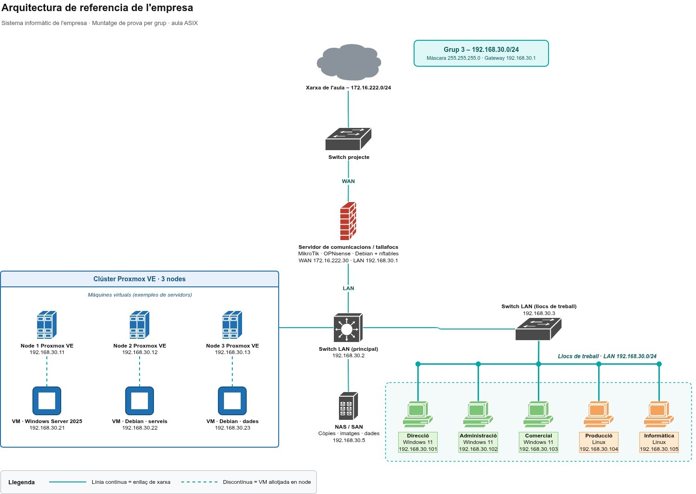

# Red del entorno de pruebas del aula

Tasca 3 «Rack i interconnexió» · RA principales: FDM RA1 c y h; RA4 a-d y g-i.

Un dato no comprobado todavía se marca **N/C**.

## 1. Esquema de la red

Hecho con draw.io. Editable: [arquitectura-red.drawio](../diagrames/arquitectura-red.drawio). Exportación:

## 2. Elementos de la red

| Elemento del esquema | Físico o virtual | Finalidad o uso | En el aula |
|---|---|---|---|
| Red del aula 172.16.222.0/24 | Física | Red compartida por los grupos; salida al exterior | Red del rack |
| Switch projecte | Físico | Une la red del aula con el servidor de comunicaciones del grupo | N/C |
| Servidor de comunicaciones / cortafuegos | Físico (MikroTik) y virtual (OPNsense, Debian + nftables) | Enrutar y filtrar el tráfico entre la WAN y la LAN | MikroTik: G3-RT-01 (hEX). OPNsense: VM en G3-PC-01. Debian + nftables: N/C |
| Switch LAN (principal) | Físico | Conecta el clúster, el NAS/SAN y el switch de puestos de trabajo | N/C |
| Switch LAN (puestos de trabajo) | Físico | Conecta los cinco clientes | N/C |
| Nodo 1, 2 y 3 Proxmox VE | Físicos | Clúster de virtualización donde se ejecutan los servidores | N/C |
| VM Windows Server 2025 | Virtual (nodo 1) | Servidor de dominio | N/C |
| VM Debian · servicios | Virtual (nodo 2) | Servidor de servicios | N/C |
| VM Debian · datos | Virtual (nodo 3) | Servidor de datos | N/C |
| NAS / SAN | Físico | Copias, imágenes y datos | G3-PC-02 (TrueNAS) |
| Dirección | Físico | Cliente Windows 11 | N/C |
| Administración | Físico | Cliente Windows 11 | N/C |
| Comercial | Físico | Cliente Windows 11 | N/C |
| Producción | Físico | Cliente Linux | N/C |
| Informática | Físico | Cliente Linux | N/C |

La configuración de red de cada interfaz (Tasca 4) está en [04-disseny](04-disseny.md#direccionamiento).

## 3. Identificación con adhesivos

Cada equipo lleva un adhesivo con su ID, el mismo del [inventario](02-inventari.md). Cada cable lleva un adhesivo en **cada extremo** con su ID y lo que une.

**Equipos**

| Adhesivo | Equipo | Pegado |
|---|---|---|
| G3-RT-01 | Router MikroTik hEX | ☐ |
| G3-SW-01 | Switch TL-SG116 | ☐ |
| G3-SW-02 | Switch LS1008G | ☐ |
| G3-SW-03 | Switch LS1008G | ☐ |
| G3-PC-01 | PC APD ALDA+ | ☐ |
| G3-PC-02 | PC Ticnova E70 SFF | ☐ |

**Cables** (una fila por cable en uso; formato del adhesivo: `G3-CAB-01 · RT-01/ether2 ↔ SW-01/p1`)

| Adhesivo | Extremo A (equipo/puerto) | Extremo B (equipo/puerto) | Pegado |
|---|---|---|---|
| G3-CAB-01 | N/C | N/C | ☐ |
| G3-CAB-02 | N/C | N/C | ☐ |
| G3-CAB-03 | N/C | N/C | ☐ |
| G3-CAB-04 | N/C | N/C | ☐ |

Evidencia: foto de los equipos y los cables etiquetados en `evidencies/t3-adhesivos-<fecha>.jpg` (N/C).

## 4. Ampliación: sala de servidores o CPD pequeño

Si estuviéramos en una sala de servidores o en un CPD, deberíamos tener:

- **Un SAI:** si se fuera la luz, deberíamos tener una alternativa para que no se apague ningún servidor y, a causa de ello, perder información.
- **Un servidor de copias de seguridad**, tanto físicas como lógicas, por si pasara alguna catástrofe natural.
