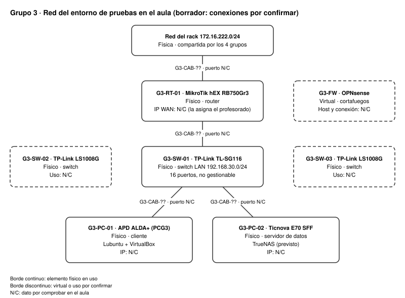

# Red del entorno de pruebas del aula

Tasca 3 · RA principales: FDM RA1 c y h; RA4 a-d y g-i.

Un dato no comprobado todavía se marca **N/C**.

## 1. Esquema de la red

Hecho con draw.io. Editable: [t3-xarxa-aula.drawio](../diagrames/t3-xarxa-aula.drawio). Exportación:

Borrador: las conexiones, los puertos y las IP se confirman en el aula.

## 2. Elementos de la red

| ID | Elemento | Físico o virtual | Finalidad o uso | Conectado a | IP |
|---|---|---|---|---|---|
| — | Red del rack 172.16.222.0/24 | Física | Red compartida por los 4 grupos; da salida a la WAN | G3-RT-01 (puerto N/C) | — |
| G3-RT-01 | Router MikroTik hEX RB750Gr3 | Físico | Enrutar el tráfico entre la red del rack y la LAN del grupo | Red del rack y G3-SW-01 (puertos N/C) | WAN: N/C (la asigna el profesorado) · LAN: N/C |
| G3-FW | Cortafuegos OPNsense | Virtual | Filtrar el tráfico entre la WAN y la LAN | N/C | N/C |
| G3-SW-01 | Switch TP-Link TL-SG116 | Físico | Conectar los equipos de la LAN 192.168.30.0/24 | G3-RT-01, G3-PC-01 y G3-PC-02 (puertos N/C) | — (no gestionable) |
| G3-SW-02 | Switch TP-Link LS1008G | Físico | N/C | N/C | — (no gestionable) |
| G3-SW-03 | Switch TP-Link LS1008G | Físico | N/C | N/C | — (no gestionable) |
| G3-PC-01 | PC APD ALDA+ (`PCG3`) | Físico | Cliente Lubuntu; anfitrión de VM con VirtualBox | G3-SW-01 (puerto N/C) | N/C |
| G3-PC-02 | PC Ticnova E70 SFF | Físico | Servidor de datos TrueNAS (previsto) | G3-SW-01 (puerto N/C) | N/C |
| G3-CAB-01… | Latiguillos RJ45 Cat6 | Físicos | Unir los equipos | Ver [apartado 3](#3-identificación-con-adhesivos) | — |

## 3. Identificación con adhesivos

Cada equipo lleva un adhesivo con su ID, el mismo del esquema y del [inventario](02-inventari.md). Cada cable lleva un adhesivo en **cada extremo** con su ID y lo que une.

**Equipos**

| Adhesivo | Equipo | Pegado |
|---|---|---|
| G3-RT-01 | Router MikroTik hEX | ☐ |
| G3-SW-01 | Switch TL-SG116 | ☐ |
| G3-SW-02 | Switch LS1008G | ☐ |
| G3-SW-03 | Switch LS1008G | ☐ |
| G3-PC-01 | PC APD ALDA+ | ☐ |
| G3-PC-02 | PC Ticnova E70 SFF | ☐ |

**Cables** (una fila por cable en uso; formato del adhesivo: `G3-CAB-01 · RT-01/ether2 ↔ SW-01/p1`)

| Adhesivo | Extremo A (equipo/puerto) | Extremo B (equipo/puerto) | Pegado |
|---|---|---|---|
| G3-CAB-01 | N/C | N/C | ☐ |
| G3-CAB-02 | N/C | N/C | ☐ |
| G3-CAB-03 | N/C | N/C | ☐ |
| G3-CAB-04 | N/C | N/C | ☐ |

Evidencia: foto de los equipos y los cables etiquetados en `evidencies/t3-adhesivos-<fecha>.jpg` (N/C).

## 4. Ampliación: sala de servidores o CPD pequeño

Pendiente: lo redacta el grupo. ¿Qué elementos tendría que tener una sala de servidores pequeña para la empresa del enunciado y para qué serviría cada uno? Cada elemento, con su justificación.
